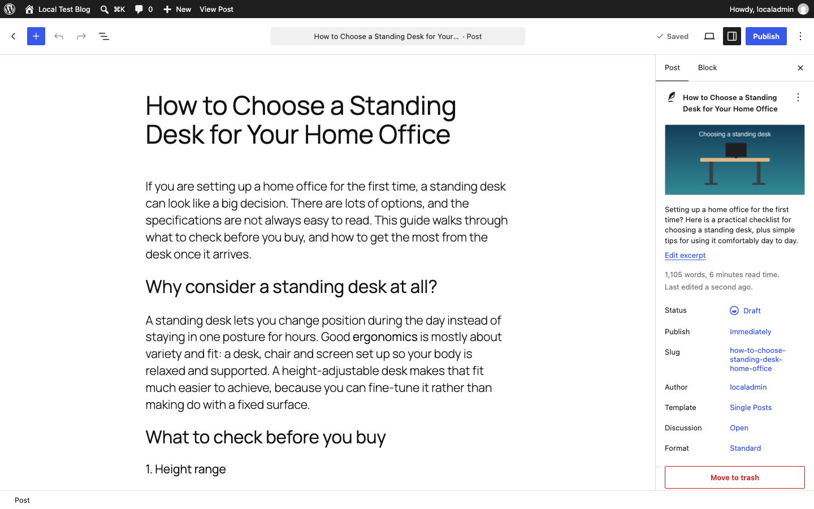
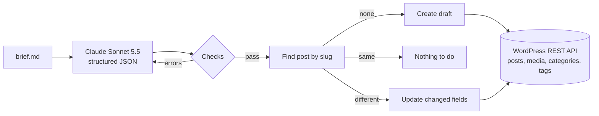
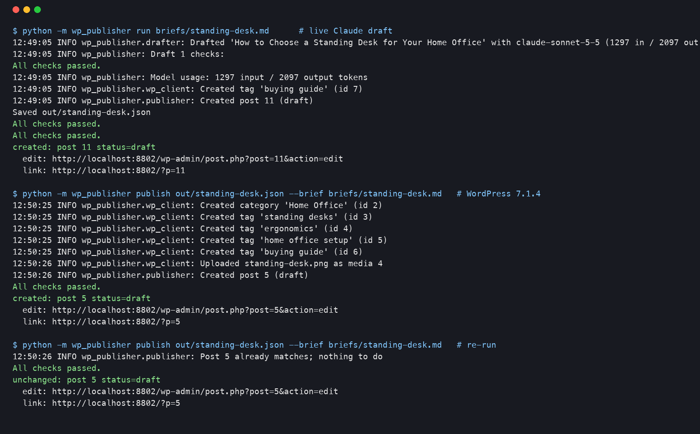

# WordPress AI Publisher

Turns a short topic brief into a finished WordPress post. Claude drafts the article as structured JSON, the code checks it (length, headings, unsafe HTML, banned claims and any statistic that is not in the brief), and only then does it go to WordPress through the REST API, as a **draft by default**. Running it again with the same article changes nothing; running it with an edited article updates the same post.



*A real run: Claude wrote the article from `briefs/standing-desk.md`, the tool created the post as a draft with its category, tags, featured image, meta description and FAQ schema. Local WordPress 7.1.4 in Docker.*

## What it does

- **Brief in, article out.** A brief is a small text file: topic, audience, keywords, length, categories, tags, a featured image, and a list of facts. Claude returns title, slug, excerpt, meta description, body HTML, FAQ, tags and categories in one JSON object (structured outputs, so the shape is guaranteed).
- **Checks before anything is sent.** Errors block publishing:
  - title 20 to 70 characters, meta description 70 to 160, a clean slug, excerpt under 300
  - body within 60% to 150% of the requested length, at least two `<h2>` sections, no `<h1>`, no skipped heading levels
  - only safe tags (no `<script>`, `<iframe>`, ``, inline styles, `on*=` handlers or `javascript:` links)
  - 2 to 8 FAQ items in plain text
  - **banned claims** ("guaranteed", "risk-free", "clinically proven", "#1"... plus any the brief adds)
  - **unverified statistics:** percentages, money, "3x", "4 out of 5", measurements, and phrases like "studies show" are flagged unless the same figure is in the brief's facts. Invented numbers are the most damaging thing an AI draft can put on a client's site, so this is an error unless you pass `--allow-unverified-stats`.
  - Missing keywords are a warning only.
- If a draft fails, Claude gets one more attempt with the list of failures (`--attempts`).
- **Publishing over the REST API** with an Application Password:
  - draft unless `--publish` is given
  - **idempotent by slug:** finds the existing post, compares title, excerpt, content, categories, tags, image and meta description, and sends only what changed (or nothing)
  - **will not touch a live post from a draft run**, so a re-run can never unpublish or silently rewrite a page that is already public
  - categories and tags are matched case-insensitively and created only if missing
  - the featured image is uploaded once and reused on later runs (matched by file name)
  - a visible FAQ section plus `FAQPage` JSON-LD schema is appended to the post
  - the meta description is saved through a tiny must-use plugin (`wordpress/mu-plugins/ai-publisher-meta.php`) that also prints it in the page head
- **Errors are clear and safe:** 401/403 stop at once with a plain message (exit code 3); 429 and 502/503/504 are retried, honouring `Retry-After` (capped at 60 s); still rate limited after the retries gives exit code 4. Every publish is appended to a JSON-lines audit log.

## How it works



| File | Job |
|---|---|
| `wp_publisher/brief.py` | reads the brief file |
| `wp_publisher/drafter.py` | Claude call with a JSON schema; `OfflineDrafter` for runs with no key |
| `wp_publisher/validate.py` | all the checks above |
| `wp_publisher/faq_schema.py` | FAQ HTML and `FAQPage` JSON-LD |
| `wp_publisher/wp_client.py` | REST client: auth, retries, terms, media |
| `wp_publisher/publisher.py` | create / update / skip logic and the live-post guard |
| `wp_publisher/cli.py` | `draft`, `check`, `publish`, `run` commands |

## Setup

```bash
python -m venv .venv && source .venv/bin/activate
pip install -r requirements.txt
cp .env.example .env     # add ANTHROPIC_API_KEY, WP_BASE_URL, WP_USERNAME, WP_APP_PASSWORD
```

On the WordPress site:

1. Create an Application Password: wp-admin > Users > Profile > Application Passwords. The user needs to be an Editor to save drafts, and an **Administrator** (on a single site) for the FAQ JSON-LD to survive, because WordPress strips `<script>` tags for users without the `unfiltered_html` capability. The tool warns if that is the case.
2. Copy `wordpress/mu-plugins/ai-publisher-meta.php` to `wp-content/mu-plugins/` for the meta description. Skip this if Yoast or Rank Math already manage descriptions (see limitations).

## Use

```bash
python -m wp_publisher run briefs/standing-desk.md              # draft, check, save as a WordPress draft
python -m wp_publisher run briefs/standing-desk.md --publish    # same, but goes live
python -m wp_publisher run briefs/standing-desk.md --dry-run    # draft and check only, no WordPress needed

# or step by step, so a person can edit the JSON in between
python -m wp_publisher draft briefs/standing-desk.md -o out/article.json
python -m wp_publisher check out/article.json --brief briefs/standing-desk.md
python -m wp_publisher publish out/article.json --brief briefs/standing-desk.md
```

`--offline` swaps Claude for a canned article so the whole flow can be tried with no API key.

Exit codes: 0 ok, 1 other error, 2 failed checks, 3 login problem, 4 still rate limited, 5 blocked by a safety rule (e.g. live post without `--publish`).

## Local WordPress for testing

`docker-compose.yml` runs WordPress 7 (PHP 8.3, Apache) and MariaDB 11, plus a WP-CLI container. The setup script installs WordPress, sets pretty permalinks, and creates an Application Password with WP-CLI, writing the settings to the git-ignored `.env.local`.

```bash
docker compose -p wpai up -d --wait
./scripts/setup_local_wp.sh                          # site on http://localhost:8802
python -m wp_publisher --env-file .env.local run briefs/standing-desk.md
```

`wordpress/mu-plugins/zz-local-test-rate-limit.php` lets the tests make the real server answer `429 Too Many Requests` (`wp option update aipub_force_429 N`). It only switches on when `WP_ENVIRONMENT_TYPE` is `local`; do not copy it to a real site.

## Tests

```bash
pip install pytest
pytest                                   # 42 unit tests, WordPress and Claude mocked
WP_INTEGRATION=1 pytest -m integration   # 5 tests against the local WordPress above
```

The unit tests run against an in-memory fake of the REST API and cover create, unchanged re-run (no writes at all), changed-fields-only updates, the live-post guard, `--publish` promotion, term and media reuse, bad credentials, missing capabilities, 429 retry with `Retry-After`, giving up after retries, capped waits, the stripped-script warning, every validation rule and the Claude request shape.

GitHub Actions runs the unit tests on Python 3.9 and 3.12, and a second job that starts the real WordPress stack in Docker and runs the integration tests. Neither needs any secret.

## Tested live

On 2 November 2026, on a Mac with Docker Engine 29.5.2 (Colima):

- **Claude draft:** `run briefs/standing-desk.md` with `claude-sonnet-5-5` produced "How to Choose a Standing Desk for Your Home Office" (809 body words, 5 sections, 4 FAQs). It passed every check on the first attempt. The only figures in it are the three facts from the brief (62 cm to 127 cm, 120 kg, 5 and 2 year warranties). The call used 1,297 input and 2,097 output tokens, about $0.02.
- **First publish** (against a WordPress 6.x container): created draft post 11, created the missing "buying guide" tag, reused the existing featured image instead of uploading it again.
- The stack was then moved to **WordPress 7.1.4** (the current release) and rebuilt from empty. Publishing the same saved article created draft post 5 with the "Home Office" category, four new tags, the uploaded image and the meta description. Re-running it printed `unchanged: post 5` and made no writes. Opening the post in the block editor and re-running again still gave `unchanged`.
- The draft preview page contains the `<meta name="description">` tag and the `FAQPage` JSON-LD (checked in headless Chromium).
- **Integration tests, 5 of 5 passed on WordPress 7.1.4:** create, unchanged re-run with no new media, update of only the changed field, `--publish` then the draft-run guard, a real `401` for a wrong Application Password, a real `429` (with `Retry-After: 1`) retried to success, and giving up after 2 retries.
- Screenshots in `media/` were taken with headless Chromium (Playwright) logged in to the local site: `wp-admin-drafts-list.png`, `wp-admin-draft-editor.png`, `draft-preview-top.png`, `draft-preview-faq.png`, plus `terminal-live-run.png` from the real command output.



## Honest limitations

- **Tested on a local WordPress in Docker, not a client's hosted site.** Real hosts can add things the local site does not have: security plugins or firewalls that block the REST API or Application Passwords, caching layers, or HTTPS-only rules. The client code is standard REST, but expect to check those on the first real site.
- **Meta description needs the small mu-plugin.** WordPress core has no meta description field. Yoast and Rank Math store theirs in their own fields, which they do not open to the REST API by default; supporting them means registering those keys, which is a short addition but was not built or tested here.
- **FAQ schema needs an Administrator** (or a user with `unfiltered_html`), otherwise WordPress removes the script tag. The visible FAQ is kept either way.
- **The statistics check is pattern-based.** It catches percentages, money, multipliers, "N out of N", common units and phrases like "studies show". It cannot catch a false claim written without a number, so a person should still read the draft, which is why the default is a draft.
- **Media reuse matches by file name.** A different image saved under the same name will not be re-uploaded; rename the file to replace it.
- **Posts only**, not pages or custom post types, and HTML content (shown as a Classic block in the editor), not native Gutenberg blocks.
- The drafting prompt was tested on one live brief. Different subjects may need different banned-claim lists or tone notes in the brief.

## Stack

Python · Anthropic Claude API (Sonnet 5.5, structured outputs) · WordPress REST API · Application Passwords · Docker Compose · MariaDB · WP-CLI · pytest · Playwright · GitHub Actions
